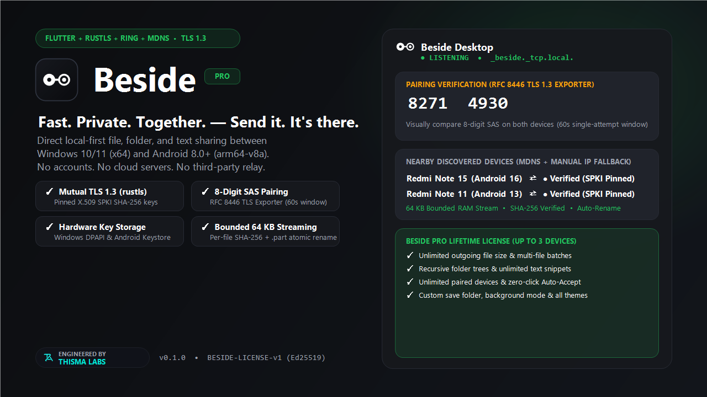
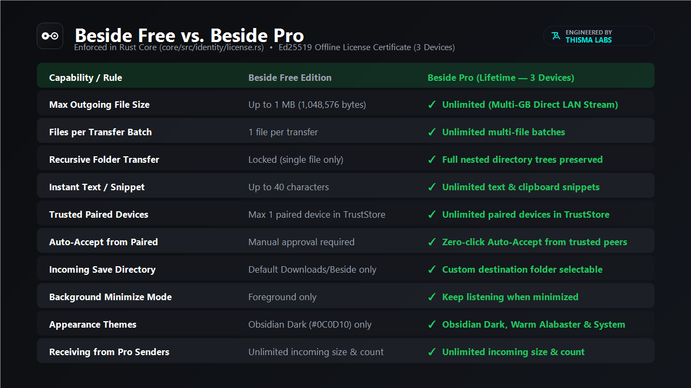

<p align="center">
  
</p>

<h1 align="center">Beside</h1>

<p align="center">
  <strong>Direct local file, folder &amp; text sharing between Windows and Android over Wi-Fi.</strong><br>
  <em>Fast. Private. Together. — Send it. It's there.</em><br>
  <sub>Engineered by <a href="https://github.com/thisma-labs">Thisma Labs</a></sub>
</p>

<p align="center">
  <a href="https://github.com/thisma-labs/beside/releases"></a>
  <a href="https://github.com/thisma-labs/beside/releases"></a>
  <a href="https://github.com/thisma-labs/beside/releases"></a>
  <a href="SECURITY.md"></a>
  <a href="LICENSE"></a>
</p>

<p align="center">
  
</p>

**Beside** is a local-first, peer-to-peer file, folder, and text sharing application for **Windows 10/11 (x64)** and **Android 8.0+ (arm64-v8a)**.

Transfers stay strictly inside your local Wi-Fi network at wire speed. No cloud servers, no accounts, no subscriptions, and zero tracking.

---

## ⚡ Key Highlights

- **Wire-Speed Gigabit LAN**: Direct peer-to-peer transfers over local Wi-Fi, mobile hotspot, or USB tethering without passing through the internet.
- **Mutual TLS 1.3 Only**: Every transfer is encrypted end-to-end with TLS 1.3 and pinned X.509 SPKI SHA-256 device key fingerprints (`rustls` + `ring`).
- **8-Digit SAS MITM Defense**: Visual SAS pairing derived from RFC 8446 / RFC 5705 TLS Exporter (`EXPORTER-beside-pairing-sas-v1`) to prevent interception on public Wi-Fi.
- **Hardware Keystore Protection**: Private keys are encrypted at rest via **Windows DPAPI** and **Android Keystore AES-256-GCM**.
- **Bounded 64 KB RAM Streaming**: Stream multi-gigabyte video or archive files with a flat memory footprint, streamed SHA-256 integrity checks, and atomic `.part` promotion.
- **Zero-Config Local Discovery**: Automatic `_beside._tcp.local.` discovery with QR code and manual IP:port fallback.

---

## 📥 Downloads (`v0.1.0`)

| Platform | Package | Format | Direct Download |
| :--- | :--- | :--- | :--- |
| **Windows 10 / 11** | Installer (Recommended) | `.exe` (12.0 MB) | [**Download Beside-Setup-v0.1.0-x64.exe**](https://github.com/thisma-labs/beside/releases/download/v0.1.0/Beside-Setup-v0.1.0-x64.exe) |
| **Windows 10 / 11** | Portable Archive | `.zip` (14.1 MB) | [**Download Beside-v0.1.0-Windows-x64.zip**](https://github.com/thisma-labs/beside/releases/download/v0.1.0/Beside-v0.1.0-Windows-x64.zip) |
| **Android 8.0+** | Signed Release APK | `.apk` (22.5 MB) | [**Download Beside-v0.1.0-Android-arm64.apk**](https://github.com/thisma-labs/beside/releases/download/v0.1.0/Beside-v0.1.0-Android-arm64.apk) |

> Checksums and cryptographic signatures are published with every release in [`SHA256SUMS.txt`](https://github.com/thisma-labs/beside/releases/download/v0.1.0/SHA256SUMS.txt).  
> Mirrors also available on [**SourceForge**](https://sourceforge.net/projects/beside-app/).

---

## 💎 Beside Free vs. Beside Pro

Beside is freemium software. Beside Free is completely functional for everyday quick transfers with no ads or expiration. A single lifetime Pro license unlocks wire-speed power features for up to 3 personal devices.

<p align="center">
  
</p>

| Capability | Beside Free | Beside Pro (Lifetime • 3 Devices) |
| :--- | :---: | :---: |
| **Max Outgoing File Size** | 1 MB (1,048,576 bytes) | **Unlimited** (Gigabit LAN speed) |
| **Files per Batch** | 1 file per transfer | **Unlimited** multi-file batches |
| **Recursive Folder Trees** | Locked | **Preserved relative paths** |
| **Instant Text & Snippets** | Up to 40 characters | **Unlimited** text & code snippets |
| **Trusted Paired Peers** | Up to 1 paired device | **Unlimited** trusted devices |
| **Zero-Click Auto-Accept** | Manual approval only | **Auto-accept from paired peers** |
| **Custom Save Directory** | Downloads/Beside | **Any folder** (Storage Access Framework) |
| **Background Listening** | Foreground only | **Listen while minimized** |
| **Appearance Themes** | Obsidian Dark | **Obsidian, Warm Alabaster, System** |
| **Receiving from Pro Users** | **Unlimited** | **Unlimited** |

### Where to Buy Beside Pro ($14.99 Lifetime):
- [**Gumroad**](https://thismalabs.gumroad.com/l/beside-pro) (Credit Card, Apple Pay, PayPal)
- [**itch.io**](https://thisma-labs.itch.io/beside) (Indie Storefront)

---

## 🔒 Verification & Checksums

Always verify the integrity of downloaded binaries before executing:

### Windows (PowerShell)
```powershell
Get-FileHash -Algorithm SHA256 Beside-Setup-v0.1.0-x64.exe
# Expected: 7542762b59bd2eb3fbf0db14f80cb6a6f886c4339213cf5ab1d1ab2555ac5632

Get-FileHash -Algorithm SHA256 Beside-v0.1.0-Windows-x64.zip
# Expected: f8c55cfde6dc83b24c9b8c747c6577eb3f9266b7138f08b4d3efd6046f61446a
```

### Android (Linux / macOS / Termux)
```bash
sha256sum Beside-v0.1.0-Android-arm64.apk
# Expected: e88e5a7465c8d6a95a9d4c5dada18224f98dba6d7ba7db6edd16023e1df98ccd
```

---

## ❓ Troubleshooting & Network Requirements

1. **Both devices must be on the same local subnet**:
   - Ensure both devices are connected to the same Wi-Fi router or phone hotspot.
2. **Wi-Fi Client Isolation (Guest Networks)**:
   - Some enterprise, coffee shop, or guest networks turn on "Client Isolation", which blocks devices from talking directly to each other. If peers cannot see each other, turn on a phone Hotspot or connect both to a standard private Wi-Fi network.
3. **Windows Defender Firewall**:
   - On first launch, Windows may show a prompt asking to allow Beside on Private networks. Check **Private networks** and click **Allow access** so local peer discovery (`_beside._tcp.local.`) can function.
4. **Manual Connection Fallback**:
   - If discovery is ever blocked by your router's multicast filtering, tap **Manual IP** or scan the sender's **QR code** in Beside to connect directly.

---

## 🛡️ Responsible Disclosure & Support

- **Bug Reports**: Open an issue on our [Issue Tracker](https://github.com/thisma-labs/beside/issues).
- **Security Inquiries**: See [SECURITY.md](SECURITY.md) for encrypted vulnerability reporting instructions.
- **License Server Portal**: [https://beside-license-worker.khthisald.workers.dev](https://beside-license-worker.khthisald.workers.dev)

---

© 2026 **Thisma Labs**. All rights reserved. Beside (`•—◎`) is a trademark of Thisma Labs.
